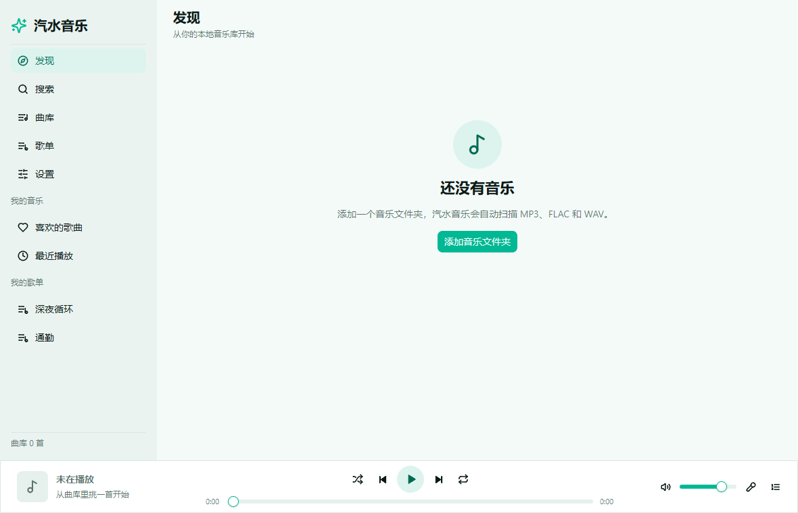
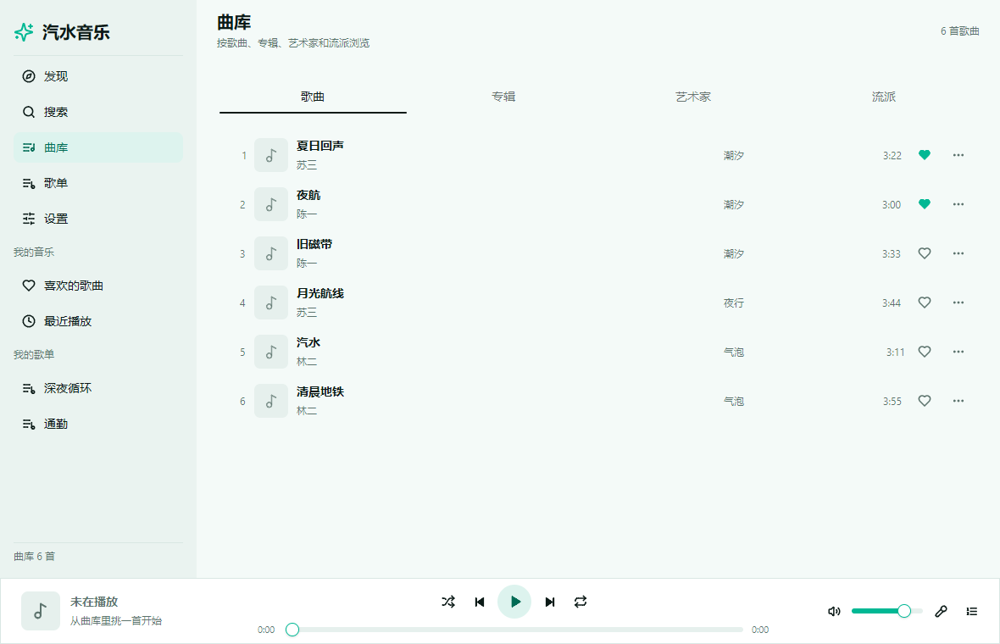
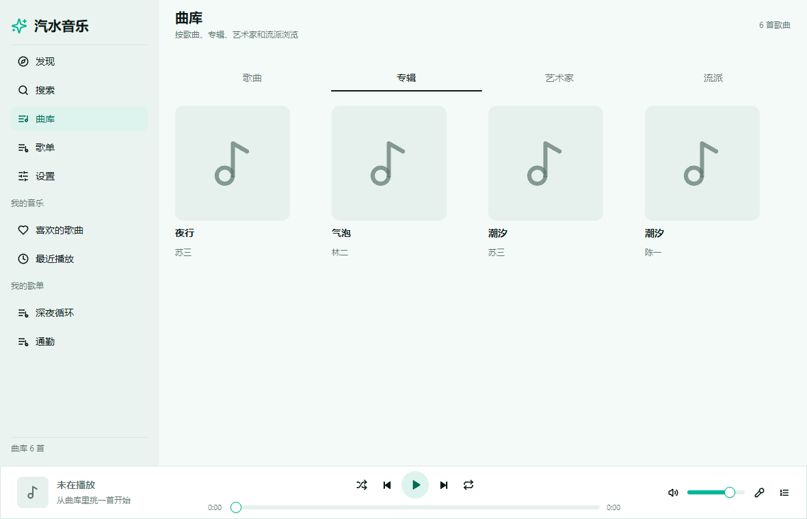
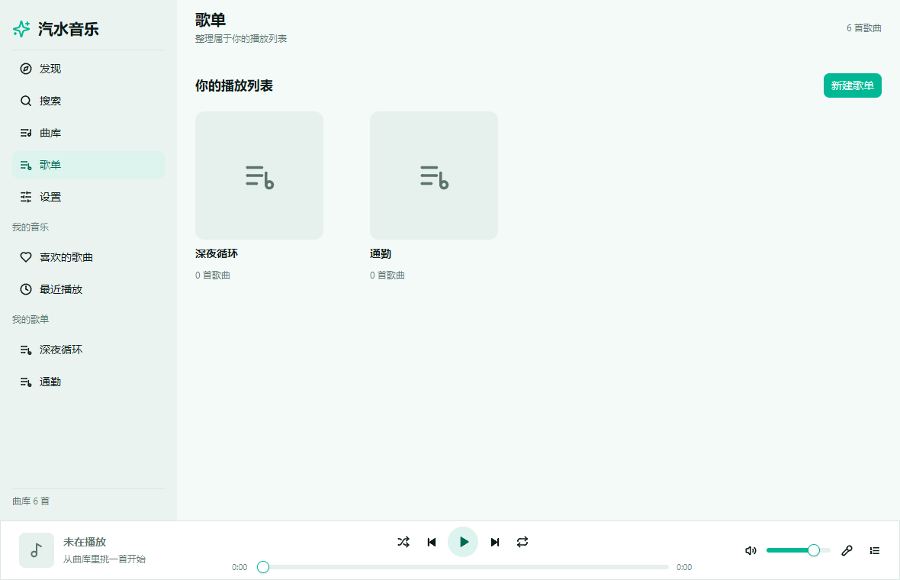
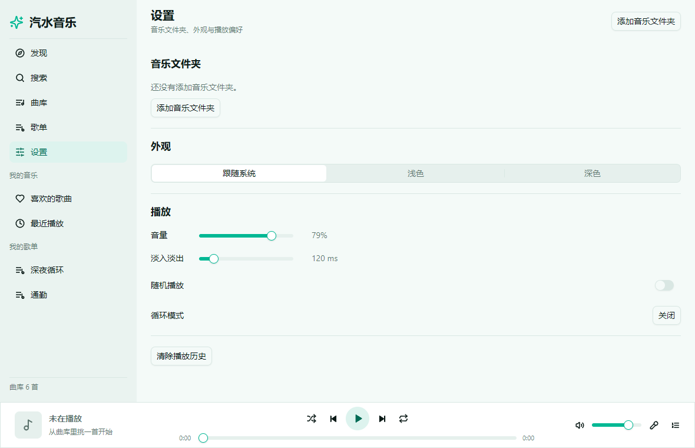
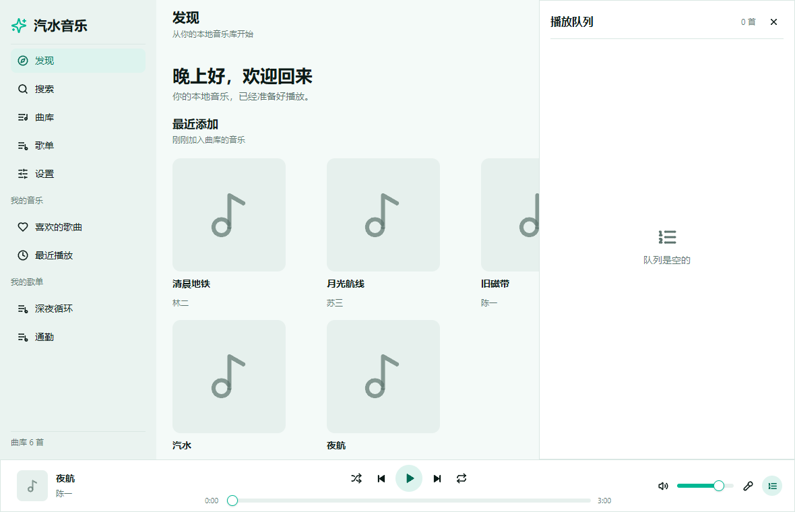
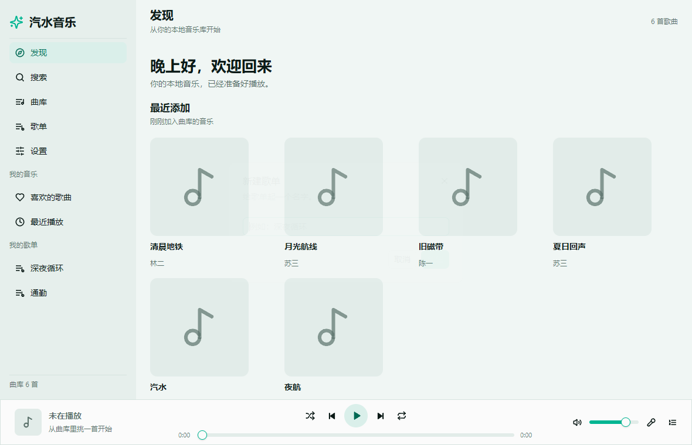
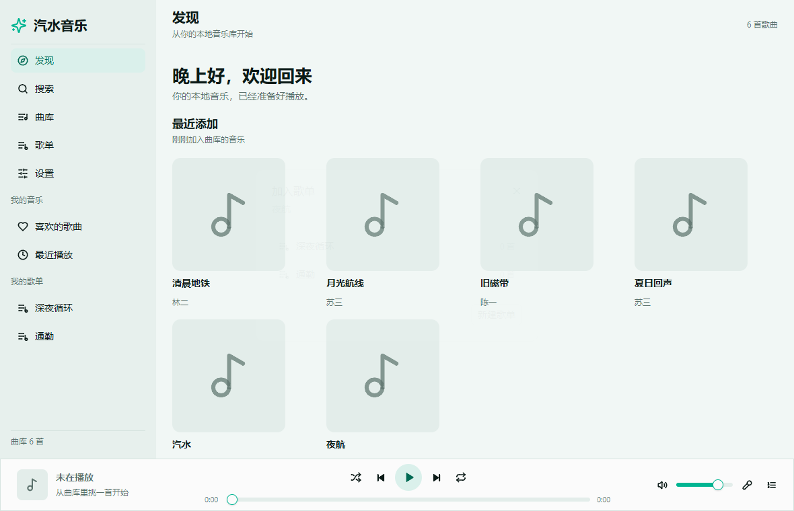
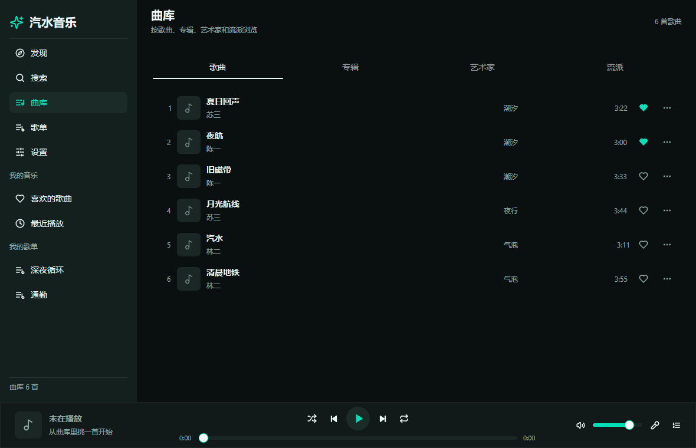

# 汽水音乐 · soda-music

用 **Go** 和 [**Viva**](https://vivaui.dev/zh/) 写的原生桌面音乐播放器：界面由 Viva 直接绘制，整个应用编译成一个原生可执行文件，不依赖浏览器内核，也不联网。

> 本地曲库 · 无账号 · 无广告 · 不上传任何数据

---

## 简介

汽水音乐是一个**本地优先**的桌面音乐播放器。把音乐文件夹交给它，它会递归扫描曲库、读取标签和内嵌封面，按歌曲 / 专辑 / 歌手 / 流派整理，并提供播放队列、歌词、歌单、收藏与播放历史。

- 交互与功能范围参考了 [egoist/mygo-cloudmusic](https://github.com/egoist/mygo-cloudmusic)。该项目以 AGPL-3.0 授权，**本项目没有复制它的任何代码**，只借鉴了功能范围。
- 界面、构建与打包基于 [Viva](https://vivaui.dev/zh/)（Apache-2.0）。

## 功能

- **曲库扫描** —— 递归扫描音乐文件夹，读取 MP3 / FLAC / WAV 的标签（标题、歌手、专辑、专辑歌手、流派、年份、音轨号、碟号）与内嵌封面；扫描在后台进行，界面不卡顿。
- **分类浏览** —— 全部歌曲、专辑、歌手、流派四个维度，外加专辑详情页与歌手详情页。
- **播放控制** —— 播放 / 暂停、上一首 / 下一首、进度拖动、音量、静音、随机播放、列表循环 / 单曲循环、淡入淡出。
- **播放队列** —— 查看当前队列、跳到任意一首、从队列移除、"下一首播放"、追加到队列。
- **歌词** —— 读取同名 `.lrc` 文件，支持一行多时间戳与翻译行；正在播放页高亮当前行并自动滚动。
- **歌单与收藏** —— 新建 / 删除歌单、把歌曲加入歌单、从歌单移除、喜欢的歌曲、最近添加、播放历史与播放次数。
- **搜索** —— 按标题 / 歌手 / 专辑匹配，结果分为歌曲、专辑、歌手三组。
- **外观** —— 跟随系统 / 浅色 / 深色主题，对中文字体友好。
- **记忆** —— 退出后记住音量、随机与循环模式、淡入淡出时长、主题、上次播放的歌曲与位置，下次启动继续。
- **纯本地** —— 不联网、不上传、不需要账号。

## 截图

| 发现 | 曲库 | 专辑 |
| --- | --- | --- |
|  |  |  |

| 歌单 | 设置 | 正在播放 |
| --- | --- | --- |
|  |  |  |

| 播放队列 | 新建歌单 | 加入歌单 |
| --- | --- | --- |
|  |  |  |

| 深色主题 |
| --- |
|  |

> 截图由 `internal/app` 的 headless 测试自动生成，命令见[开发](#本地开发)。

## 支持的格式

| 容器 | 解码 | 说明 |
| --- | --- | --- |
| MP3 | 内置（`go-mp3`） | 按帧解析，支持可变码率；标签读取 ID3v1 / ID3v2 |
| FLAC | 内置（`mewkiz/flac`） | 原生 FLAC 解码；标签读取 Vorbis Comment 与 FLAC picture |
| WAV | 内置 | PCM 8 / 16 / 24 / 32 位整数与 32 位 IEEE 浮点，单声道到多声道 |

- 播放引擎基于 [`ebitengine/oto/v3`](https://github.com/ebitengine/oto)，输出固定为 48 kHz 立体声，其他采样率与声道数会自动重采样与混音。
- 标签读取使用 [`dhowden/tag`](https://github.com/dhowden/tag)。

## 快速开始

### 环境要求

- Go 1.27 或更新（`go.mod` 里声明了 `go 1.27.3`）
- 一个 C 编译器**不需要** —— 所有依赖都是纯 Go

### 运行

```bash
git clone https://github.com/<你的用户名>/soda-music.git
cd soda-music
go mod download
go tool viva dev .
```

`viva dev` 会带热重载启动应用；只想跑一次可以直接：

```bash
go run .
```

### 使用

1. 打开应用，进入 **设置 → 添加音乐文件夹**，选择存放音乐的目录。
2. 等待后台扫描完成，曲库会出现在 **曲库** 页，按歌曲 / 专辑 / 歌手 / 流派分组。
3. 单击任意一首开始播放；底部是播放栏，点击封面进入 **正在播放** 页看歌词。
4. 在 **歌单** 页新建歌单；在歌曲行点 `···`，选 **加入歌单…**。

## 键盘快捷键

| 按键 | 作用 |
| --- | --- |
| `空格` | 播放 / 暂停 |
| `←` / `→` | 后退 / 前进 5 秒 |
| `Ctrl` + `←` / `Ctrl` + `→` | 上一首 / 下一首 |
| `↑` / `↓` | 音量增减 5% |
| `Esc` | 关闭最上层的浮层、对话框或菜单 |

输入框获得焦点时，方向键和可打印字符交给输入框处理。

## 数据与状态文件

应用把状态和缓存写进系统的用户配置目录：

| 平台 | 位置 |
| --- | --- |
| Windows | `%AppData%\soda-music` |
| macOS | `~/Library/Application Support/soda-music` |
| Linux | `~/.config/soda-music` |

| 文件 | 内容 |
| --- | --- |
| `state.json` | 音乐文件夹、歌单、收藏、播放历史、播放次数、音量、主题、循环 / 随机、淡入淡出、上次播放位置 |
| `library.json` | 上次扫描结果的缓存，启动时先加载再后台刷新 |
| `art/` | 从音频文件里提取出来的封面缓存 |

删除这个目录即可把应用恢复到全新状态；音乐文件本身不会被改动。

## 本地开发

```bash
# 格式化（只格式化源码目录，避免扫到 work/ 之类的本地目录）
gofmt -l assets internal main.go

# 静态检查
go vet ./...

# 单元测试
go test ./... -count=1

# 编译
go build ./...
```

`internal/app` 里有一个 headless 测试，会把 10 个界面状态渲染成 PNG，写到 `outputs/screenshots/`：

```bash
go test ./internal/app -run TestScreenshots -count=1
```

如果当前环境没有可用的渲染后端，这个测试会自动跳过（`t.Skip`），不会让 CI 失败。

## 打包与发布

打包参数来自 [`viva.toml`](viva.toml)，产物写到 `build/`。

```bash
# 当前平台的原生程序
go tool viva build

# 交叉构建
go tool viva build --target windows --arch amd64
go tool viva build --target linux   --arch amd64

# 安装包
go tool viva package --target windows --arch amd64 --format nsis,zip --no-sign
go tool viva package --target linux   --arch amd64 --format tar.gz,deb --no-sign
go tool viva package --target darwin  --arch arm64 --format app,zip,dmg --no-sign
```

产物命名规则是 `<executable>-<version>-<target>-<arch>.<ext>`，Windows 安装包带 `-setup.exe` 后缀。

### 平台注意事项

| 目标 | 说明 |
| --- | --- |
| Windows | `zip` 随时可打；`nsis` 需要 `makensis`（`choco install nsis`） |
| Linux | `tar.gz` 与 `deb` 都由纯 Go 生成，不需要 `dpkg` |
| macOS | **必须在 macOS 上构建**，Metal 桥接无法交叉编译；`dmg` 需要 `hdiutil` |

### GitHub Actions

仓库里有两个工作流：

- [`.github/workflows/ci.yml`](.github/workflows/ci.yml) —— 每次 push 和 PR 都会跑：`gofmt` 检查、`go vet`、`go test ./...`、`go build ./...`。
- [`.github/workflows/release.yml`](.github/workflows/release.yml) —— 打 `v*` 标签或手动触发时，在四个 runner 上并行打包：

  | Runner | 目标 | 产物 |
  | --- | --- | --- |
  | `macos-latest` | darwin / arm64 | `.app`、`.zip`、`.dmg` |
  | `macos-latest` | darwin / amd64 | `.app`、`.zip`、`.dmg` |
  | `windows-latest` | windows / amd64 | NSIS 安装包、`.zip` |
  | `ubuntu-latest` | linux / amd64 | `.tar.gz`、`.deb` |

  所有产物都会上传为 workflow artifact；如果是标签触发，还会自动附加到对应的 GitHub Release。

发布一个新版本：

```bash
git tag v0.1.0
git push origin v0.1.0
```

## 项目结构

```
.
├── main.go                     程序入口
├── viva.toml                   应用元数据与打包配置
├── assets/                     图标（SVG 源文件 + 编译后的 Go 代码）与应用图标
├── internal/
│   ├── audio/                  解码（MP3 / FLAC / WAV）、重采样、播放引擎
│   ├── catalog/                曲库模型、扫描、标签读取、状态与缓存持久化
│   ├── lyrics/                 LRC 解析与当前行匹配
│   ├── player/                 队列、播放控制、循环 / 随机 / 淡入淡出
│   └── app/                    Viva 界面：页面、播放栏、浮层、主题、事件
├── tools/icon/                 把 PNG 转成应用图标的小工具
├── docs/screenshots/           README 用的界面截图
└── .github/workflows/          CI 与发布工作流
```

## 已知限制

- 只支持本地文件，没有在线音乐源、没有账号体系。
- 歌词只读取与音频同名的 `.lrc` 文件，不支持内嵌歌词。
- macOS 的 `.dmg` 与签名 / 公证需要在 macOS 上完成，本项目默认产出未签名包。

## 致谢

- [Viva](https://vivaui.dev/zh/) —— 用 Go 写原生界面的框架，本项目的界面与打包都靠它。
- [egoist/mygo-cloudmusic](https://github.com/egoist/mygo-cloudmusic) —— 功能范围的参考。
- [Lucide](https://lucide.dev/) —— 图标。
- 所有[第三方依赖](THIRD_PARTY_NOTICES.md)的作者。

## 许可证

[MIT](LICENSE) © 2026 soda-music contributors

第三方依赖的许可证见 [THIRD_PARTY_NOTICES.md](THIRD_PARTY_NOTICES.md)。